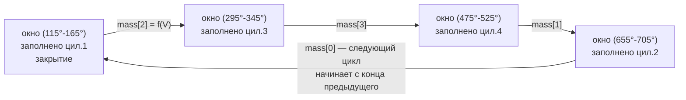

# План: Вариант A — свежее MAP-окно в момент впрыска + вынос MAP/misfire из handoff

Дата: 2026-09-23. Статус: ПЛАН на согласование (ничего из кода ещё не менялось).

Цель (два связанных изменения):

1. **Вариант A топливной трубы**: масса впрыска всегда считается от самого
   свежего ЗАКРЫТОГО MAP-окна, а не от окна цилиндровой давности (720°).
   В handoff остаётся ОДНО умножение на планирующий зуб.
2. **Вынос из handoff всего, что связано с MAP и misfire**: `engineModules.apply_all`
   (единственные реальные потребители - `MapAveragingModule::onEnginePhase` и
   `MisfireController::onEnginePhase`, плюс ~22 виртуальных no-op вызова на зуб)
   переносится на планировщик, запускаемый из executor раз в цикл (TDC-hook).

Ожидаемый эффект на handoff: минус ~5-15 мкс на каждом зубе (виртуальные вызовы +
4x isPhaseInRange) и минус весь `evaluateSegment` (десятки float-операций на idle) -
на планируемых зубах экономия ~35-70 мкс.

---

## 1. Массопровод (Вариант A)

### Модель: ОДНО окно, заполняется предыдущим цилиндром

Не 4 параллельных окна (и не 4 сенсора), а ОДНО окно как сущность: один
`mapSampler` + один averager (`MapFast`). Окно по очереди проходит фазовые
области цилиндров в порядке зажигания (за цикл 4 закрытия, как на диаграмме -
это ОДНО окно на разных фазах, а не четыре разных). Каждое закрытие окна
принадлежит ПРЕДЫДУЩЕМУ цилиндру - тому, чья фазовая область только что
измерилась (окно на 115°-165° заполнено цилиндром 1). Свежее значение окна =
`mapPerCylinder[предыдущий]` и `SensorType::MapFast` (единственный «текущий» MAP).

Массопровод (инвариант: `injectionMass[c]` согласована с базисом
`injectionMassMapBasis[c]`):

- **200 Hz (`periodicFastCallback`)** перезаписывает `injectionMass[c]` опорной
  (reference-based) массой и кладёт `injectionMassMapBasis[c] = referenceMap`.
- **`endAveraging`** (executor, prio 5) после `stop()`: окно закрыто со значением
  `V` от цилиндра `C` -> пересчитываем массу ПРЕЕМНИКА (следующий впрыск в порядке
  зажигания): `injectionMass[S] *= V / basis[S]`, `basis[S] = V`.
- **`onTriggerTooth`** (handoff) делает финальное одно-умножение
  `mass *= текущееMapFast / basis[c]` - ЛОКАЛЬНО, не трогая stored-состояние
  (нет гонки с писателями из executor/200 Hz).

При обычном потоке `basis == referenceMap`, и формула на зубе в точности
`mass *= MapFast / referenceMap` (как в задании - буквально текущее MapFast).
Базис-массив нужен ровно для одного: чтобы первичный пересчёт в `endAveraging`
и refresh на зубе не перемножались (иначе MAP вошёл бы дважды); когда
`endAveraging` уже применил окно, на зубе дробь == 1. Если базис не выдержать -
общее «текущее окно» для всех цилиндров начнёт двойное применение каждый раз,
когда закрытие окна и планирующий зуб пришлись между двумя 200 Hz-тиками
(штатный случай >~4000 об/мин).

Карта «закрытие окна -> масса» (окно заполнено цилиндром C, массу получает
преемник в порядке зажигания 1-3-4-2; индексы 0-based):

Подтверждённая семантика (2026-09-23): один источник свежего давления с
обновлением каждые ~180° (4 закрытия за цикл, 4 записи `mapPerCylinder[]` за
цикл); для ТЕКУЩЕГО цилиндра давление обязано быть от ПРЕДЫДУЩЕГО - каждый
цилиндр считает average, следующий цилиндр использует этот average для смеси;
цепочка непрерывна через границу цикла: первый цилиндр нового цикла использует
значение последнего окна предыдущего цикла (край W4 -> mass[0] на диаграмме).

`преемник(c)` = цилиндр с минимальным положительным угловым сдвигом после `c`
(обобщённо по `cylinders[i].getAngleOffset()`, цикл 4 итерации на закрытие окна).
Ротация averager'ов `cylinderNumber % SAMPLER_DIMENSION` (MapFast/MapFast2 и
несколько сенсоров для двойных банков) УБИРАЕТСЯ ПОЛНОСТЬЮ в этом pass:
`fastMapSensor2..4` и `mapCombiner2` удаляются из init_map.cpp, масса ходит
только через `MapFast`.

### Изменения по файлам

| файл | изменение |
| --- | --- |
| `firmware/controllers/algo/engine_state.txt` | `float referenceMap` (TS-канал kPa) + `float[MAX_CYLINDER_COUNT iterate] injectionMassMapBasis` (internal) |
| `firmware/controllers/algo/engine2.cpp` | в `periodicFastCallback`: `engineState.referenceMap = referenceMap`; из пер-цилиндрового цикла УБРАТЬ блок `massForCyl *= cylMap/referenceMap` (его роль переходит в оконный конвейер), вместо него `injectionMassMapBasis[c] = referenceMap`; массив `kCylMapSensor` и зависимость от MapFast2/3/4 УДАЛЯЮТСЯ |
| `firmware/init/sensor/init_map.cpp` | удалить `fastMapSensor2/3/4` + `mapCombiner2` и их регистрацию; `getMapAvg()` вырождается в один averager (сигнатуру оставить для совместимости); `SensorType::Map` остаётся FallbackSensor(MapFast, MapSlow) |
| `firmware/controllers/modules/map_averaging/map_averaging.h` | `MapAverager::stop()` возвращает `float` (свежее значение окна, 0 = нет сэмплов); `getCylinderNumber()`; у `mapSampler` удаляется `startArmedNt` (больше нет per-tooth arms); у модуля: убрать `onEnginePhase`, добавить `scheduleNextCycleWindows()` + `static firingOrderSuccessor(uint8_t)`; helper `refreshInjectionMassForCylinder(uint8_t, float)` (inline-заглушка, если `MODULE_MAP_AVERAGING` не определён) |
| `firmware/controllers/modules/map_averaging/map_averaging.cpp` | ОДНО окно: `startAveraging` всегда ведёт один averager (`getMapAvg(0)`, ротация `currentMapAverager` по cylinderNumber/SAMPLER_DIMENSION удаляется), `mapPerCylinder[закрывшийся цилиндр]` остаётся; `endAveraging`: `float fresh = arg->stop()` -> `rescale(преемник, fresh)`, затем pin low; helper `rescaleInjectionMass(cyl, fresh)` (gate: SD-режим, `fresh > 0`, `basis > 0`); `refreshInjectionMassForCylinder`: `mass *= SensorType::MapFast / basis[c]` - без поиска сенсора предшественника (окно одно); successor по угловым сдвигам |
| `firmware/controllers/engine_cycle/main_trigger_callback.cpp` | в `InjectionEvent::onTriggerTooth` сразу после чтения `injectionMass[cyl]`: `injectionMassGrams = refreshInjectionMassForCylinder(cyl, injectionMassGrams);` |

---

## 2. Вынос MAP-окон из handoff (вариант B из diskонтраф 09-23: планирование раз в цикл)

Сегодня `MapAveragingModule::onEnginePhase` на каждом зубе делает 4x
`isPhaseInRange` и на 4 зубах за цикл вставляет события в executor ПОД
CriticalSectionLocker внутри handoff. Заменяем на планирование ВСЕХ окон раз
в цикл из executor (TDC-hook) с конвертацией угол->время через `scheduleByAngle`
(тот же паттерн, что у `startKnockSampling`/TDC-mark):

- удалить `MapAveragingModule::onEnginePhase`;
- новый метод `MapAveragingModule::scheduleNextCycleWindows()`: для каждого окна
  `offset = wrap(mapAveragingStart[i] - tdcPosition())` и
  `scheduleByAngle(&samplers[i].timer, nowNt, offset, startAveraging)`;
  `startAveraging` (без изменений) дальше сам планирует `endAveraging` на
  `&samplers[i].timer` (последовательное переиспользование узла - паттерн dwell);
- `rpm_calculator.cpp::tdcMarkCallback`: планировать `onTdcCallback` не только для
  sniffer, а когда `isEngineSnifferEnabled || isMapAveragingEnabled ||
  misfireDetectionEnabled` (при выключенных - ноль новых событий в handoff,
  существующие тесты с `tdcMarkEnabled=false` не задеваются вообще);
- `onTdcCallback` дополнительно вызывает `scheduleNextCycleWindows()` +
  `MisfireController::scheduleNextCycleSegments()`.

Известный и принятый tradeoff (опция B из `docs/report.md` 09-23): конвертация
угол->время выполняется за полный цикл вперёд по текущему `oneDegreeUs` -
при разгоне 4000 rpm/s дрейф окна несколько градусов; окно 50° на общем ресивере
это поглощает. Точность события в executor - микросекунды (событие предспланировано,
проблемы «100% late» 08-23 не возникает - та была от поздней ВСТАВКИ на граничном зубе).

---

## 3. Вынос misfire + анализ «цилиндр, который уже был»

**Анализ (заключение):** текущий `MisfireController::onEnginePhase` уже оценивает
ПРОШЕДШИЙ цилиндр: окно сидит на expansion-ходе (TDC_i + start..end), и
`evaluateSegment` вызывается при пересечении КОНЦА окна - т.е. сегмент
принадлежит цилиндру, отгоревшему к этому моменту. Требование «смотреть по
цилиндру, который уже был» переносится в новую механику без изменения семантики:
событие конца сегмента цилиндра i (executor) оценивает сегмент цилиндра i строго
после его завершения.

Перенос:
- удалить `MisfireController::onEnginePhase`;
- добавить `scheduleNextCycleSegments()` (TDC-hook, executor): гейт
  `misfireDetectionEnabled && idle`, проверка ширины окна (`windowTooNarrow` -
  теперь раз в цикл, не на зуб), затем на каждый цилиндр два события:
  `m_segStartEvent[i]` (+`captureSegmentStart`) и `m_segEndEvent[i]`
  (+`finishSegment` -> `evaluateSegment`); `endOffset = startOffset + width`
  (с учётом переноса через 720);
- `resetting` состояния при выходе из idle - в планере, как сейчас в onEnginePhase.

**Решение (подтверждено пользователем): misfire переносится ЦЕЛИКОМ на executor** -
без какого-либо захвата edge-времён в handoff. Принятая потеря точности
(задокументирована): время сегмента теперь исполняемое (executor `nowNt`), а не
фронт зуба. Оба края сегмента имеют симметричное смещение - базовая EMA его
поглощает; джиттер ±10-100 мкс против сигнала пропуска ~1-3 мс на idle - шум
ISR-вставки, усиливаемый в wobble, чувствительность снижается незначительно.
Модуль idle-only, поэтому высокооборотный handoff-бюджет этим не задет.

---

## 4. Удаление `engineModules.apply_all` из handoff

`main_trigger_callback.cpp`: убрать блок `engine->engineModules.apply_all(...)`
полностью. Виртуальный хук `EngineModule::onEnginePhase` остаётся в базовом
классе (никто больше его не переопределяет - кандидат на удаление отдельным
pass'ом, не в этой задаче).

---

## 5. Тесты

- `unit_tests/tests/controllers/modules/map_averaging/test_map_averaging.cpp`:
  - тесты `onFastCallback` - без изменений (чистая математика углов);
  - тесты `onEnginePhase*` - переписать на `scheduleNextCycleWindows()`
    (`triggerShape.tdcPosition = 0` в тесте, offset == абсолютный угол окна);
    проверка старта/конца окна по времени, как сейчас;
  - новые: `firingOrderSuccessor` (0->2, 2->3, 3->1, 1->0 - порядок 1-3-4-2);
  - новые: `endAveraging` масштабирует массу преемника (линейный конвертер +
    `submit()` + прогон времени: mass[2] = 10 * fresh/80, basis = fresh);
  - новые: `refreshInjectionMassForCylinder` - refresh через МОКАНЬЙ `MapFast` при
    basis=reference (`mass *= MapFast/referenceMap`), отсутствие double-apply при
    basis=fresh, pass-through для non-SD;
- новый `unit_tests/tests/controllers/modules/misfire/test_misfire_planner.cpp`:
  TT_TOOTHED_WHEEL_60_2, окно 10..50°, idle принудительно true: после
  `scheduleNextCycleSegments()` в очереди 2*N событий; прогон времени -> старт
  захватывает время, конец -> `misfireLastSegUs > 0` / базис засеян; при
  `misfireDetectionEnabled=false` - ноль событий;
- известные 12 pre-existing падений не должны измениться (у них
  `tdcMarkEnabled=false`, tdc-вставки не добавляются, MAP/misfire выключены).

---

## 6. Валидация

1. `cd unit_tests && ./test.sh` (GCC); затем `make clean && make CC=clang -j12` +
   `./build/rusefi_test` (clang-канал) - по правилу «оба компилятора».
2. Board build: `cd firmware/config/boards/m74_9 && ./compile_m74_9.sh`.
3. Генерируемые файлы (engine_state_generated.h, ini) **не коммитим**, при
   необходимости `touch firmware/integration/rusefi_config.txt` для форса регенерации.
4. После сборки: `docs/report.md` (датированная запись) + свернуть durable-выводы
   в `CLAUDE.md` (секция MAP/isr-priority) - по правилам проекта.

---

## Решения, зафиксированные с пользователем (2026-09-23)

1. Окно ОДНО (`MapFast`), заполняется предыдущим цилиндром; 4 закрытия за цикл,
   4 записи `mapPerCylinder[]`; на зубе буквально `mass *= MapFast / basis[c]`.
   Цепочка непрерывна через границу цикла (последнее окно -> первый цилиндр
   следующего цикла).
2. Misfire - ЦЕЛИКОМ на executor, без edge-захвата в handoff.
3. `MapFast2..4`+`mapCombiner2` - удалить СРАЗУ в этом pass.
4. Пер-цилиндровую коррекцию из 200 Hz убрать полностью; для non-SD поведение
   байт-в-байт прежнее.
5. `referenceMap` - TS-канал (kPa) для логов.
6. `SensorType` enum-значения (`MapFast2..4`, `Map2`, `MapSlow2`) в sensor_type.h
   пока НЕ трогаю (они часть registry/инструментария) - удаляются только живые
   инстансы и регистрация; если enum тоже нужен чище - отдельный pass, скажите.
